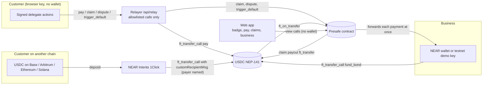

# Presafe

**Paid upfront. Protected anyway.** A business that takes customers' money before it delivers posts a USDC bond on NEAR and gets a public badge. If it misses the date it promised, the customers it took money from claim the bond back, without a wallet and without gas. They can pay from another chain through NEAR Intents.

- **Live app:** https://presafe.ahmardchain.workers.dev (NEAR testnet, test USDC)
- **Contract:** [`presafe-app.testnet`](https://testnet.nearblocks.io/address/presafe-app.testnet)
- **Track:** NEAR HACKATHON, Real-World Money (`realworld`)
- **Status:** the contract, the web app, gasless claims and the relayer run on testnet. Paying from another chain with NEAR Intents was verified on mainnet with a real payment; on the testnet demo it is shown as a live quote (see [Pay from another chain](#pay-from-another-chain)).

## The problem

Businesses take customers' money upfront (festival and event tickets, tours, courses, custom orders), spend it, then fail to deliver. The customers become unsecured creditors and rarely see their money again.

- **United States.** New York's attorney general sued the organizers of the cancelled Evolutions Festival over about $264K in ticket and vendor money. Only 11 of 521 buyers were refunded, and only by disputing card charges. The state says no escrow or required financial protection was held, and asks for a $500K performance bond. ([FingerLakes1, 2026-09-30](https://www.fingerlakes1.com/2026/09/30/new-york-sues-canceled-festival-promoters-over-refunds/))
- **South Africa.** The Hey Neighbour festival was cancelled, and promised refunds were still unpaid. ([Daily Maverick, 2025-10-27](https://www.dailymaverick.co.za/article/2025-10-27-organisers-of-hey-neighbour-festival-under-fire-refund-promises-fall-flat-for-fans))

## How Presafe solves it

1. **The business posts a bond.** It deposits USDC into the Presafe contract and reserves part of it for each event, tour or order (an "obligation"). Its public badge shows the bond and how much of the customers' money it covers.
2. **The customer pays with protection.** Before paying, the customer sees what they could claim back. The payment goes straight to the business; Presafe does not hold it. The customer gets an on-chain receipt.
3. **The business delivers, or the customers claim.** If the business marks the obligation delivered and nobody successfully disputes it, the reserve unlocks back to the business. If the deadline and grace period pass without delivery, anyone can open claims, and each customer claims their share of the reserve with one tap, without gas.

**Why a bond and not escrow.** Escrow locks the presale cash that organizers need to pay venues and artists, so they avoid it. A bond lets the business keep and use the customer's money while customers stay protected up to the size of the bond. Regulators already use bonds (New York's demand above; travel protection schemes such as the UK's ATOL), but they are paperwork-heavy and hard for small businesses to get. Presafe makes one public, instant and checkable by anyone.

## Verify in 2 minutes

1. **No wallet needed.** Open [the demo business's badge page](https://presafe.ahmardchain.workers.dev/b/lagos-sound-fest.testnet) → you see its bond, coverage per obligation and claims paid, read live from the contract. The embeddable badge is at [`/b/lagos-sound-fest.testnet/badge.svg`](https://presafe.ahmardchain.workers.dev/b/lagos-sound-fest.testnet/badge.svg).
2. **Pay with protection.** Open [`/pay/8`](https://presafe.ahmardchain.workers.dev/pay/8) (an obligation open until Dec 20, 2026) and tap **Pay 2.00 test USDC** → "You're covered." No wallet and no gas: the browser signs, the relayer submits, and test USDC is minted for you. Below it, **Pay from another chain** shows a live NEAR Intents quote.
3. **See a default and a gasless claim end to end (about 5 minutes).** Go to [`/business`](https://presafe.ahmardchain.workers.dev/business) → **Start demo business** → register → **Get 10 test USDC** → **Fund bond** → create an obligation with **In 3 min (demo)** → **Copy pay link**, open it, pay. After about 4 minutes open [`/claims`](https://presafe.ahmardchain.workers.dev/claims) → **Deadline missed: open claims** → **Claim** → "Paid back".
4. **Check the chain.** This prints the demo business's bond, coverage and claims paid, the same numbers as the badge page:

```bash
curl -s https://test.rpc.fastnear.com -H 'content-type: application/json' -d '{"jsonrpc":"2.0","id":1,"method":"query","params":{"request_type":"call_function","finality":"final","account_id":"presafe-app.testnet","method_name":"get_business","args_base64":"eyJhY2NvdW50X2lkIjoibGFnb3Mtc291bmQtZmVzdC50ZXN0bmV0In0="}}' | python3 -c "import json,sys; print(bytes(json.load(sys.stdin)['result']['result']).decode())"
```

Transactions from a run on the live app on 2026-11-07 (obligation #7):

| Step | Network | Transaction |
| --- | --- | --- |
| Business funds bond | testnet | [4fd2Pii…](https://testnet.nearblocks.io/txns/4fd2PiinZUwqJTPyRucysyWKS9dBQE6ZowiCGMVGgjor) |
| Customer pays with protection (relayed) | testnet | [BxXLLBy…](https://testnet.nearblocks.io/txns/BxXLLByZbBsSH8uGNM1TVXRJoMfUfnCV7pRxe1bhBDCh) |
| Default triggered after the deadline (relayed) | testnet | [4TaLEWL…](https://testnet.nearblocks.io/txns/4TaLEWLu12rsxTqPqUNgdnNbnnpMsMBk9acKfwLSQ3KD) |
| Gasless claim (meta transaction) | testnet | [5RpNDfE…](https://testnet.nearblocks.io/txns/5RpNDfE2D8wjtvPQyh6GQrLJGqKQ789UzbXwXENKYGv) |
| Pay from another chain: 1.00 USDC on Base delivered by 1Click with `customRecipientMsg` | mainnet | [94gPxba…](https://nearblocks.io/txns/94gPxbaXa8cs4noBg1XvRNZF84TSi1HDJ3G1UVziCCSg) |

After the claim, the customer held 2.00 test USDC and their NEAR balance was still the 0.01 they were onboarded with.

## Demo video

A 1:35 narrated walkthrough: the problem and the fix as a short animation, then the live site: badge, pay, missed deadline, gasless claim. _Link to the X post added once it is published._

## How NEAR is used

| NEAR feature | What Presafe does with it |
| --- | --- |
| NEP-141 fungible tokens (USDC) | Bonds and payments are USDC transfers into the Presafe contract through `ft_transfer_call`. Mainnet USDC is `17208628f84f5d6ad33f0da3bbbeb27ffcb398eac501a31bd6ad2011e36133a1`; testnet uses a mock NEP-141 token. |
| NEAR Intents (1Click API) | A customer pays from another chain (USDC on Base, Arbitrum, Ethereum or Solana, or USDT on NEAR). 1Click swaps it to USDC on NEAR and delivers it into Presafe with `customRecipientMsg`, so it lands as a covered receipt in one step. Verified on mainnet with a real 1.00 USDC payment from Base. |
| Meta transactions (NEP-366) | Customers pay (testnet), dispute, claim and trigger default by signing a delegate action in the browser; Presafe's self-hosted relayer submits it and pays the gas. |
| Named accounts | The badge identity is a readable account such as `<business>.near`, shown on the badge page and in the embeddable SVG. |

## Architecture



## How it works in detail

### Contract rules

Source: [`contract/presafe/src/lib.rs`](contract/presafe/src/lib.rs). Payments arrive through `ft_transfer_call` with `msg` `{"action":"pay","obligation_id":N}`, optionally with `"payer":"<account>"` so that a third party (such as a 1Click delivery) can pay on a customer's behalf. Bond funding uses `{"action":"fund_bond"}`. Any other token, or an unparseable `msg`, is returned.

| Action | Who | When | Effect |
| --- | --- | --- | --- |
| `fund_bond` (via `ft_transfer_call`) | Business | Any time | Adds USDC to the business's unlocked bond. |
| `create_obligation` | Business | Unlocked bond ≥ reserved amount | Reserves part of the bond for one obligation (for example, an event). |
| `pay` (via `ft_transfer_call`) | Customer | Obligation `Open`, before `deliver_by` | Forwards the payment to the business immediately and records a covered receipt. |
| `mark_delivered` | Business | After `deliver_by`, before grace ends | Opens the challenge window. |
| `dispute` | Receipt holder | During the challenge window | If disputes reach the threshold (holders of ≥ 20% of covered value), the status becomes `Disputed`. |
| `resolve` | Arbiter | `Disputed` | Sets `Delivered` or `Defaulted`. |
| `trigger_default` | Anyone | `deliver_by` + grace passed and not marked delivered | Sets `Defaulted`. |
| `declare_default` | Business or arbiter | Not yet settled | Sets `Defaulted` (a business can admit non-delivery early). |
| `claim` | Receipt holder | `Defaulted` | Pays `min(receipt amount, pro-rata share of reserved bond)`. Each receipt can be claimed once. |
| `release` | Anyone | Marked delivered and the challenge window closed with no successful dispute | Status becomes `Delivered`; the reserve unlocks back to the business. |
| `add_reserve` | Business | `Open` | Moves more unlocked bond into the reserve. |
| `withdraw_bond` | Business | Any time | Withdraws unlocked bond only. |

Coverage ratio = reserved bond / total covered prepayments. Payments are not blocked when coverage is below 100%; the ratio is shown before paying. Each business pays for its own storage from a NEAR deposit, so customers never pay storage.

### Customer keys and gasless actions

A customer needs no wallet. On first payment the browser generates an ed25519 key and stores it in `localStorage`; the customer's NEAR account is the 64-character implicit account derived from that key. On testnet the relayer creates it by sending 0.01 NEAR. Every later action is signed locally as a NEP-366 delegate action and submitted by the relayer ([`web/lib/server/relayer.ts`](web/lib/server/relayer.ts)), which only accepts `claim`, `dispute` and `trigger_default` on the Presafe contract, `ft_transfer_call` into Presafe with the signer as payer, and (testnet only) a capped test-token `mint`.

The key lives in one browser, so `/claims` offers "Copy recovery key" and "Restore".

### Business page

`/business` has two ways in:

- **Connect a NEAR wallet** through `@hot-labs/near-connect` (the real path; the only one on mainnet). The wallet signs each action.
- **Testnet only: "Start demo business".** The browser generates a key, the relayer funds its implicit account with 0.3 testnet NEAR (at most 3 per IP per hour), and the page signs locally.

From the dashboard a business registers (0.05 NEAR storage deposit), gets test USDC (testnet), funds and withdraws its bond, creates obligations (with a 3-minute demo deadline preset), copies a pay link, marks delivered, releases the bond after the dispute window, adds reserve, or admits it can't deliver. Verified on testnet through the UI: register, fund, create, mark delivered, release, withdraw.

### Pay from another chain

The pay page offers USDC on Base, Arbitrum, Ethereum or Solana, or USDT on NEAR, through NEAR Intents 1Click. On the testnet demo it shows a live `dry: true` quote ([`web/app/api/quote/route.ts`](web/app/api/quote/route.ts)): no deposit address is created and nothing can be sent, because Intents has no testnet. The route itself was proven on mainnet; see [the spike](#mainnet-1click-spike).

## Repository layout

```
contract/presafe/            Presafe contract (Rust, near-sdk 5.30.1)
contract/mock-ft/            Testnet-only mock USDC (NEP-141, 6 decimals, capped open mint)
contract/integration-tests/  near-sandbox integration tests
web/                         Next.js app: landing, badge, pay, claims and business pages,
                             relayer (/api/relay), onboarding (/api/onboard), 1Click quotes (/api/quote)
scripts/testnet/             Deploy and seed scripts for NEAR testnet (print a plan; sign only with --execute)
spike/                       Mainnet 1Click experiment: recorder contract and scripts (not part of the product)
```

## Run it locally

Requirements: Rust with the `wasm32-unknown-unknown` target, [`cargo-near`](https://github.com/near/cargo-near) 0.23.0, Node.js 22.

```bash
cargo install cargo-near --version 0.23.0 --locked   # Linux needs libudev-dev and pkg-config
```

### Contract tests

```bash
contract/run-tests.sh
```

This builds both contracts, runs the unit tests (34 for Presafe, 3 for the mock token), then runs 4 integration tests on a local NEAR sandbox with real cross-contract calls:

| Test | What it checks |
| --- | --- |
| `pay_default_and_gasless_claim` | Bond funding, payment forwarded to the business at once, coverage ratio, early default refused, default after grace, excess reserve unlocked, a claim relayed as a meta transaction (the claimant's NEAR balance does not change), double claim refused. |
| `wrong_token_and_bad_msg_are_refunded` | Another NEP-141 token and an unparseable `msg` are returned to the sender. |
| `named_payer_gets_the_receipt` | A third party pays with `"payer"` in the msg (the 1Click delivery shape); the receipt belongs to the named payer. |
| `delivered_release_and_withdraw` | Locked bond cannot be withdrawn; mark delivered, release after the challenge window, withdraw. |

The sandbox node requires an open-files limit of 65535. Where a container caps it lower, `run-tests.sh` preloads a small test-only shim ([`fdlimit_shim.c`](contract/integration-tests/fdlimit-shim/fdlimit_shim.c)); on a normal machine it is not used.

### Web app

```bash
cd web && npm ci
```

```bash
npm run dev
```

Then open http://localhost:3000. It reads the live testnet contract by default. Paying, claiming and the demo business need a relayer: put `RELAYER_ACCOUNT_ID` and `RELAYER_PRIVATE_KEY` for a funded testnet account in `web/.env.local`.

### Your own testnet deployment

```bash
cd scripts/testnet && npm ci
```

```bash
node deploy.mjs
```

`deploy.mjs` prints the plan (faucet accounts, contract deploys, token registration); run it again with `--execute` to sign. `seed.mjs` creates the demo business and an obligation the same way.

## Deploy (Cloudflare Workers)

The web app deploys to Cloudflare Workers with the [OpenNext adapter](https://developers.cloudflare.com/workers/framework-guides/web-apps/opennext/). Config: [`web/wrangler.jsonc`](web/wrangler.jsonc), [`web/open-next.config.ts`](web/open-next.config.ts). The live app is built by Cloudflare Workers Builds from `main` with root directory `web`, build command `npx opennextjs-cloudflare build` and deploy command `npx opennextjs-cloudflare deploy`. To deploy from your machine:

```bash
cd web && npx wrangler login
```

```bash
npx wrangler secret put RELAYER_PRIVATE_KEY
```

```bash
npm run cf:deploy
```

The deployed app exposes a testnet-only faucet and relayer (method allowlist plus per-IP rate limits). Do not deploy that configuration against mainnet.

## Environment variables

Web app ([`web/.env.example`](web/.env.example)):

| Variable | Where | Purpose |
| --- | --- | --- |
| `NEXT_PUBLIC_NEAR_NETWORK` | build | `testnet` (default) or `mainnet`. |
| `NEXT_PUBLIC_NEAR_RPC_URL` | build | RPC endpoint; default `https://test.rpc.fastnear.com`. |
| `NEXT_PUBLIC_PRESAFE_CONTRACT` | build | Presafe contract; default `presafe-app.testnet`. |
| `NEXT_PUBLIC_USDC_CONTRACT` | build | USDC token; default the testnet mock `presafe-musdc.testnet`. |
| `NEXT_PUBLIC_DEMO_BUSINESS` | build | Business featured on the landing page. |
| `RELAYER_ACCOUNT_ID` | runtime | Account that pays gas for allowlisted relayed calls. Set in `wrangler.jsonc`. |
| `RELAYER_PRIVATE_KEY` | runtime, secret | Its key. A Worker secret; never commit it. |
| `ONECLICK_JWT` | runtime, optional | 1Click API key. Empty means 1Click is called without a key and charges its unauthenticated fee ([fees](https://docs.near-intents.org/resources/fees.md)). |

Scripts ([`.env.example`](.env.example)): `ONECLICK_API_BASE`, `ONECLICK_JWT` (optional) and `SPIKE_MAINNET_RPC_URL` for `spike/scripts`; `NEAR_RPC_URL` for `scripts/testnet`. Real values go in `.env`, which is git-ignored.

## Mainnet 1Click spike

Question: can USDC delivered by NEAR Intents 1Click arrive in a contract already tied to a specific obligation and customer?

On 2026-11-07 we paid 1.00 USDC on Base through a 1Click quote with `customRecipientMsg` set, delivering to a throwaway recorder contract on mainnet ([`spike/recorder`](spike/recorder/src/lib.rs)) that logs what `ft_on_transfer` receives:

| Field seen by `ft_on_transfer` | Value |
| --- | --- |
| `msg` | `{"action":"pay","obligation_id":"spike-1","payer":"ahmardchain.near"}`, delivered unchanged |
| `sender_id` | `intents.near` (not the customer) |
| `predecessor_id` | `17208628f84f5d6ad33f0da3bbbeb27ffcb398eac501a31bd6ad2011e36133a1` (native USDC) |
| `amount` | 999798 (0.999798 USDC; nothing refunded) |

Deposit to `SUCCESS` took about 30 seconds. Base deposit `0x8c908afcb96b1267cd78a4092cd4f23863fcb6b54ed38486f5e6794041536af3`; NEAR delivery [`94gPxba…`](https://nearblocks.io/txns/94gPxbaXa8cs4noBg1XvRNZF84TSi1HDJ3G1UVziCCSg); recorder deploy [`71tuSGX…`](https://nearblocks.io/txns/71tuSGX3tthDFhKta8vZ9YKWFpzdcFLgo2sbUi7ysT6E). Afterwards the USDC and the remaining NEAR were returned and the throwaway account was deleted ([`spike/scripts/return.mjs`](spike/scripts/return.mjs)).

Design consequence: a customer on another chain pays Presafe in one step. The 1Click quote delivers USDC to the Presafe contract with `customRecipientMsg = {"action":"pay","obligation_id":N,"payer":"<customer NEAR account>"}`. Because `sender_id` is `intents.near`, the payer must be named in `msg`, which is why the contract accepts a `payer` field.

## Disclosures

- **All code in this repository was written during NEAR HACKATHON** (the window opened 2026-10-19). No code is reused from the author's earlier projects, including the "Climb" escrow contract on Arc.
- **Other hackathon entries:** Presafe is the author's only NEAR HACKATHON entry.
- **AI assistance:** built with Claude Code. The demo video's narration is AI-generated.
- **Libraries, templates and assets** (all versions pinned):

| Library | Version | Used for |
| --- | --- | --- |
| near-sdk, near-contract-standards | 5.30.1 | Contracts, NEP-141 receiver and mock token |
| near-sandbox, near-api (Rust), tokio | 0.4.0, 0.8.7, 1 | Integration tests |
| cargo-near | 0.23.0 | Contract builds |
| near-api-js | 7.4.0 | Web app (signing, meta transactions, relayer), deploy and spike scripts |
| borsh | 2.0.0 | Decoding signed delegate actions in the relayer |
| @hot-labs/near-connect | 0.12.0 | Wallet connection for businesses |
| next, react, react-dom | 16.4.5, 19.3.1 | Web app |
| tailwindcss, @tailwindcss/postcss | 4.3.5 | Styling |
| shadcn (CLI and `button` component), cn, class-variance-authority, @base-ui/react, tw-animate-css | 4.23.0, 0.5.2, 0.7.1, 1.9.0, 1.4.0 | UI component setup |
| Magic UI `number-ticker` (adapted: renders the real value server-side), `animated-beam`, `border-beam` | from magicui.design, MIT | Count-up numbers, money-flow diagram |
| motion, lucide-react | 14.10.1, 1.70.0 | Animation, icons |
| geist, @fontsource/instrument-serif | 1.9.2, 5.3.0 | Fonts (OFL) |
| @opennextjs/cloudflare, wrangler | 1.20.16, 4.158.0 | Cloudflare Workers deployment |
| dotenv | 17.2.3 | Spike scripts |

## Known limitations

- **Arbiter trust.** A disputed delivery is settled by an arbiter account (by default one run by Presafe). Customers trust that arbiter.
- **Non-event obligations.** The default rule is date-based. Services without a clear delivery date need a different claim rule.
- **Coverage below 100%.** If the bond is smaller than the covered prepayments, each claim is paid pro rata and customers recover only part of their money.
- **Rejected 1Click deliveries bounce to `intents.near`.** If Presafe rejects a 1Click delivery (for example, the obligation closed between quote and delivery), the token contract refunds `sender_id`, which is `intents.near`, not the customer. The app must only quote open obligations; holding rejected deliveries for the named payer is future work.
- **Named payer is not verified.** When `msg` names a payer, the contract records the receipt for that account without proof that it funded the payment. Anyone can create a receipt this way, but only by paying the business real USDC, so it cannot be used to drain a bond for free; it can dilute other customers' pro-rata share if the bond is smaller than covered payments.
- **Pro-rata dust and unclaimed reserve.** After a default, reserve that is never claimed (or rounding remainders) stays locked; there is no sweep yet.
- **Browser-held customer keys.** Convenient and gasless, but a customer who clears browser data without backing up the key loses access to their receipts. Customers with a NEAR wallet should be able to pay from it directly (not built yet).
- **Relayer abuse limits are basic.** A per-IP rate limit and a strict method allowlist. Enough for a testnet demo, not for production.
- **Testnet keys.** The demo's arbiter, relayer and contract accounts use keys generated during development; a real deployment would use the operator's own accounts.
- **No Intents testnet.** The contract flow runs on testnet; the 1Click route was shown on mainnet with a small real payment, and the testnet demo shows live dry-run quotes.

## License

[MIT](LICENSE)
