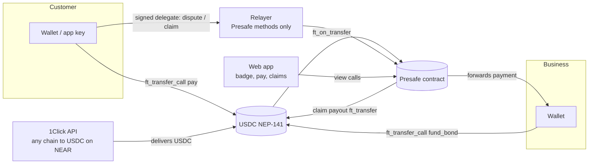

# Presafe

> **Status: in development for NEAR HACKATHON (track `realworld`).** Sections marked _TBD_ are filled in as each part ships. Nothing below claims a feature that is not built yet.

A business that takes customers' money upfront posts a stablecoin bond on NEAR and gets a public, verifiable badge. If it does not deliver by the promised date, the customers it took money from claim from the bond, without holding gas, and they can pay in from any chain.

## The problem

Businesses take customers' money upfront (festival and event tickets, tours, courses, custom orders), spend it, then fail to deliver. Customers end up as unsecured creditors.

- **United States.** New York's attorney general sued the organizers of the cancelled Evolutions Festival over about $264K in ticket and vendor money. Only 11 of 521 buyers were refunded, and only by disputing card charges. The state says no escrow or required financial protection was held, and asks for a $500K performance bond. ([FingerLakes1, 2026-09-30](https://www.fingerlakes1.com/2026/09/30/new-york-sues-canceled-festival-promoters-over-refunds/))
- **South Africa.** The Hey Neighbour festival was cancelled and promised refunds were still unpaid. ([Daily Maverick, 2025-10-27](https://www.dailymaverick.co.za/article/2025-10-27-organisers-of-hey-neighbour-festival-under-fire-refund-promises-fall-flat-for-fans))
- **Australia.** Bluesfest went into liquidation, and ticket holders are unsecured creditors. _(Primary source link TBD.)_

**Why a bond and not escrow.** Escrow locks presale cash that organizers need to pay venues and artists, so they avoid it. A bond lets the business keep and use the customer's money while customers stay protected up to the bond. Regulators already use bonds (New York's demand above; travel protection schemes such as the UK's ATOL), but they are paperwork-heavy and hard for small businesses to get.

## Verify in 2 minutes

_TBD once the testnet contract and the badge page are live._

1. **No wallet needed.** Open the badge page of the demo business: `<URL TBD>/b/<account TBD>` → you see the bond size, the coverage ratio per obligation, and the claims paid.
2. **Contract state.** Run `<view command TBD>` → you see the same numbers straight from the chain.
3. **Transactions.** See the table below.

| Step | Network | Transaction |
| --- | --- | --- |
| Business funds bond | testnet | _TBD_ |
| Customer pays with protection | testnet | _TBD_ |
| Default triggered | testnet | _TBD_ |
| Gasless claim (meta transaction) | testnet | _TBD_ |
| Any-chain pay-in through 1Click | mainnet | _TBD_ |

## How NEAR is used

| NEAR feature | What Presafe does with it |
| --- | --- |
| NEP-141 fungible tokens (USDC) | Bonds and payments are stablecoin transfers into the Presafe contract through `ft_transfer_call`. Mainnet USDC is `17208628f84f5d6ad33f0da3bbbeb27ffcb398eac501a31bd6ad2011e36133a1`; testnet uses a mock NEP-141 token. |
| NEAR Intents (1Click API) | A customer pays, or a business funds its bond, from another chain and token. 1Click swaps it into USDC on NEAR. _Delivery design: see [Spike: 1Click into the contract](#spike-1click-into-the-contract)._ |
| Meta transactions (NEP-366) | Customers pay (testnet), dispute, claim and trigger default by signing a delegate action in the browser; Presafe's self-hosted relayer submits it and pays the gas. The relayer only accepts `claim`, `dispute` and `trigger_default` on the Presafe contract, and `ft_transfer_call` into Presafe (plus the capped test-token `mint` on testnet). |
| Named accounts | The badge identity is a readable account such as `<business>.near`, shown on the badge page and in the embeddable SVG. |

## Architecture

_Draft; updated as components land._



## Business page

`/business` has two ways in:

- **Connect a NEAR wallet** through `@hot-labs/near-connect` (the real path; the only one on mainnet). The wallet signs each action.
- **Testnet only: "Start demo business".** The browser generates a key, the relayer funds its implicit account with 0.3 testnet NEAR, and the page signs locally. This lets judges try the business side without a testnet wallet.

From the dashboard a business registers (0.05 NEAR storage deposit), gets test USDC (testnet), funds and withdraws its bond, creates obligations (with a 3-minute demo deadline preset), copies a pay link, marks delivered, releases the bond after the dispute window, adds reserve, or admits it can't deliver.

Verified on testnet on 2026-11-07 through the real UI as a demo business: register, get 10 test USDC, fund 5, create a 3-minute obligation, mark delivered, release after the window, withdraw. End state on chain: obligation `Delivered`, bond 0, wallet 10 test USDC.

## Customer keys and gasless actions

A customer needs no wallet. On first payment the browser generates an ed25519 key and stores it in `localStorage`; the customer's NEAR account is the 64-character implicit account derived from that key. On testnet the relayer creates it by sending 0.01 NEAR. Every later action is signed locally as a NEP-366 delegate action and submitted by the relayer.

Verified on testnet on 2026-11-07 through the real UI: pay 2 test USDC into an obligation, wait past its deadline, open claims, claim. The customer received 2 test USDC and their NEAR balance stayed at the 0.01 they were onboarded with.

Trade-off: the key lives in one browser. Clearing browser data loses it, so `/claims` offers "Copy recovery key" and "Restore".

## Contract rules

Source: [`contract/presafe/src/lib.rs`](contract/presafe/src/lib.rs). Payments arrive through `ft_transfer_call` with `msg` `{"action":"pay","obligation_id":N}`, optionally with `"payer":"<account>"` so that a third party (such as a 1Click `customRecipientMsg` delivery) can pay on a customer's behalf. Bond funding uses `{"action":"fund_bond"}`.

| Action | Who | When | Effect |
| --- | --- | --- | --- |
| `fund_bond` (via `ft_transfer_call`) | Business | Any time | Adds USDC to the business's unlocked bond. Other tokens are refunded. |
| `create_obligation` | Business | Unlocked bond ≥ reserved amount | Reserves part of the bond for one obligation (for example, an event). |
| `pay` (via `ft_transfer_call`) | Customer | Obligation `Open` | Forwards the payment to the business immediately and records a covered receipt. |
| `mark_delivered` | Business | After `deliver_by` | Opens the challenge window. |
| `dispute` | Receipt holder | During the challenge window | If disputes reach the threshold (holders of ≥ 20% of covered value), the status becomes `Disputed`. |
| `resolve` | Arbiter | `Disputed` | Sets `Delivered` or `Defaulted`. |
| `trigger_default` | Anyone | `deliver_by` + grace passed and not marked delivered | Sets `Defaulted`. |
| `claim` | Receipt holder | `Defaulted` | Pays `min(receipt amount, pro-rata share of reserved bond)`. Each receipt can be claimed once. |
| `release` | Anyone | Marked delivered and the challenge window closed with no successful dispute | Status becomes `Delivered`; the reserve unlocks back to the business. |
| `declare_default` | Business or arbiter | Not yet settled | Sets `Defaulted` (a business can admit non-delivery early). |
| `add_reserve` | Business | `Open` | Moves more unlocked bond into the reserve. |
| `withdraw_bond` | Business | Any time | Withdraws unlocked bond only. |

Coverage ratio = reserved bond / total covered prepayments. Payments are not blocked when coverage is below 100%; the ratio is shown before paying.

## Local setup

```
contract/presafe/            Presafe contract (Rust, near-sdk 5.30.1)
contract/mock-ft/            Testnet-only mock USDC (NEP-141, 6 decimals, capped open mint)
contract/integration-tests/  near-sandbox integration tests
scripts/testnet/             Deploy and seed scripts for NEAR testnet (print a plan; sign only with --execute)
web/                         Next.js app: landing, badge, pay, claims and business pages
web/lib/server/relayer.ts    Meta transaction relayer (served at /api/relay), restricted by an allowlist
spike/                       Day-1 experiment: 1Click delivery into a contract (not part of the product)
```

Requirements: Rust with the `wasm32-unknown-unknown` target, [`cargo-near`](https://github.com/near/cargo-near) 0.23.0, Node.js 22.

```bash
cargo install cargo-near --version 0.23.0 --locked   # Linux needs libudev-dev and pkg-config
```

## Environment variables

See [`.env.example`](.env.example). Real values go in `.env`, which is git-ignored.

| Variable | Required | Purpose |
| --- | --- | --- |
| `ONECLICK_API_BASE` | yes | 1Click API base URL (`https://1click.chaindefuser.com`). |
| `ONECLICK_JWT` | no | 1Click API key. When empty, the app calls 1Click without a key, and 1Click charges its unauthenticated fee (see [Fees](https://docs.near-intents.org/resources/fees.md)). |
| `NEAR_NETWORK` | yes | `testnet` or `mainnet`. |
| `NEAR_RPC_URL` | yes | RPC endpoint, for example `https://test.rpc.fastnear.com`. |

## Tests

```bash
contract/run-tests.sh
```

This builds both contracts, runs the unit tests (34 for Presafe, 3 for the mock token), then runs 4 integration tests on a local NEAR sandbox with real cross-contract calls:

| Test | What it checks |
| --- | --- |
| `pay_default_and_gasless_claim` | Bond funding, payment forwarded to the business at once, coverage ratio, early default refused, default after grace, excess reserve unlocked, a claim relayed as a meta transaction (the claimant's NEAR balance does not change), double claim refused. |
| `wrong_token_and_bad_msg_are_refunded` | Another NEP-141 token and an unparseable `msg` are returned to the sender. |
| `named_payer_gets_the_receipt` | A third party pays with `"payer"` in the msg (the 1Click delivery shape); the receipt belongs to the named payer. |
| `delivered_release_and_withdraw` | Locked bond cannot be withdrawn; mark delivered, release after the challenge window, withdraw. |

The sandbox node requires an open-files limit of 65535. Where a container caps it lower, `run-tests.sh` preloads a small test-only shim ([`fdlimit_shim.c`](contract/integration-tests/fdlimit-shim/fdlimit_shim.c)); on a normal machine it is not used.

## Spike: 1Click into the contract

_In progress._ The question: can USDC delivered by 1Click arrive in the Presafe contract already tied to a specific obligation? The 1Click quote API has an experimental `customRecipientMsg` field that delivers through `ft_transfer_call` instead of `ft_transfer`. The spike tests it with a $1 mainnet payment into a throwaway contract that only records what it receives. Results and the chosen design go here.

## Disclosures

- **All code in this repository was written during NEAR HACKATHON** (the window opened 2026-10-19). No code is reused from the author's earlier projects, including the "Climb" escrow contract on Arc.
- **Other hackathon entries:** Presafe is the author's only NEAR HACKATHON entry.
- **AI assistance:** built with Claude Code.
- **Libraries and templates:** _list kept current as dependencies are added._

| Library | Version | Used for |
| --- | --- | --- |
| _TBD_ | | |

## Known limitations

- **Arbiter trust.** A disputed delivery is settled by an arbiter account (by default one run by Presafe). Customers trust that arbiter.
- **Non-event obligations.** The default rule is date-based. Services without a clear delivery date need a different claim rule.
- **Coverage below 100%.** If the bond is smaller than the covered prepayments, each claim is paid pro rata and customers recover only part of their money.
- **Named payer is not verified.** When `msg` names a payer, the contract records the receipt for that account without proof that it funded the payment. Anyone can create a receipt this way, but only by paying the business real USDC, so it cannot be used to drain a bond for free; it can dilute other customers' pro-rata share if the bond is smaller than covered payments.
- **Pro-rata dust and unclaimed reserve.** After a default, reserve that is never claimed (or rounding remainders) stays locked; there is no sweep yet.
- **Browser-held customer keys.** Convenient and gasless, but a customer who clears browser data without backing up the key loses access to their receipts. Customers with a NEAR wallet should be able to pay from it directly (not built yet).
- **Relayer abuse limits are basic.** A per-IP rate limit and a strict method allowlist. Enough for a testnet demo, not for production.
- **No Intents testnet.** The contract flow runs on testnet; the 1Click leg can only be shown on mainnet with small amounts.

## License

[MIT](LICENSE)
