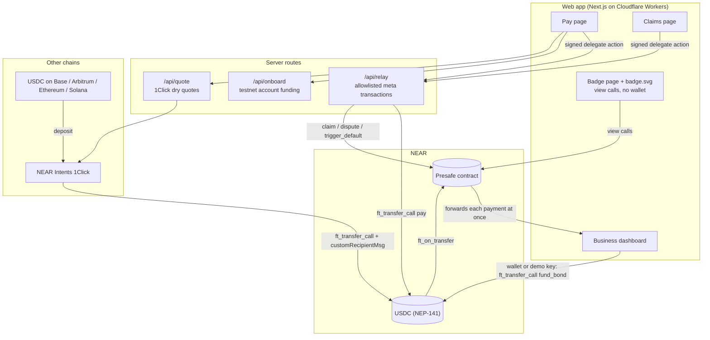
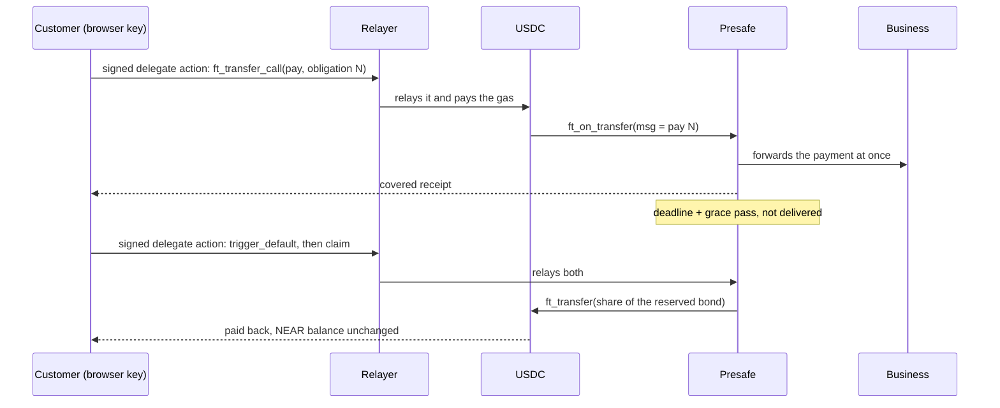
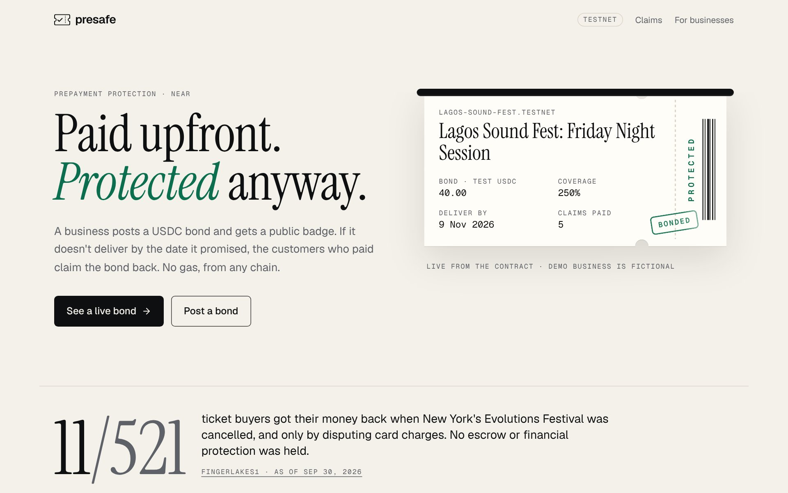
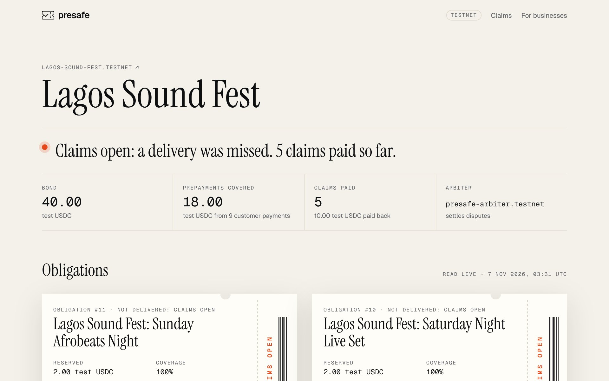
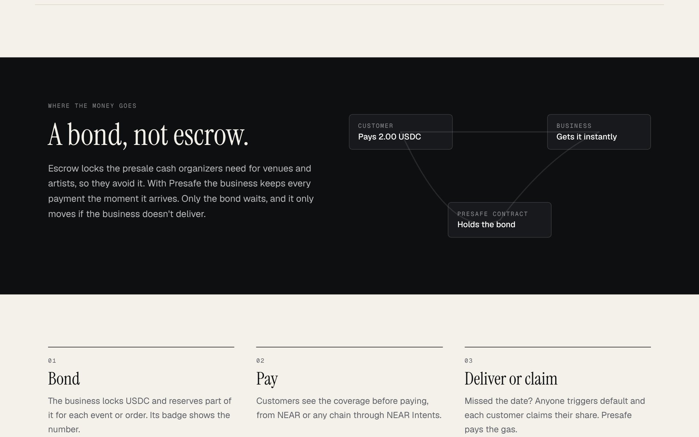
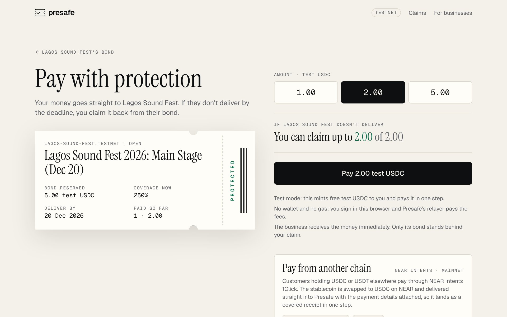
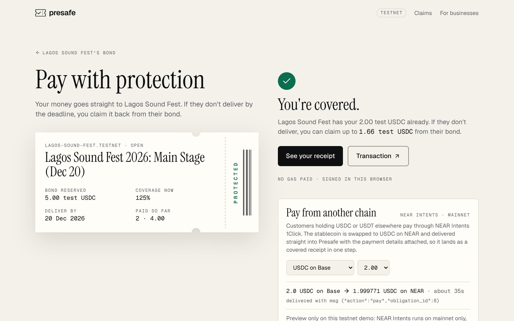
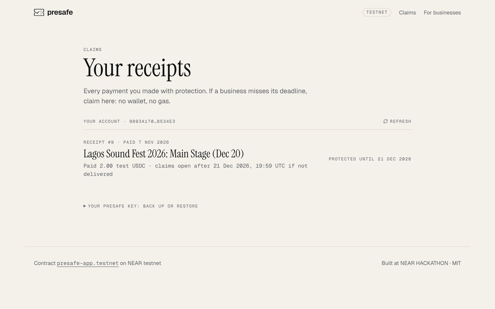

<div align="center">

# Presafe

### Paid upfront. Protected anyway.

A business that takes customers' money before it delivers posts a USDC bond on NEAR and gets a public badge.<br/>
If it misses the date it promised, its customers claim the bond back, with no wallet and no gas, and they can pay in from another chain through NEAR Intents.

[](https://presafe.ahmardchain.workers.dev)
[](https://x.com/Ahmardchain/status/2118905952887816627)
[](https://nearhackathon.com)

[](https://github.com/ahmardchain/presafe/actions/workflows/contract-tests.yml)


[](LICENSE)

</div>

| | |
| --- | --- |
| **Live app** | https://presafe.ahmardchain.workers.dev (NEAR testnet, test USDC) |
| **Demo video** | 1:35 on X: https://x.com/Ahmardchain/status/2118905952887816627 |
| **X post** | https://x.com/Ahmardchain/status/2118905952887816627 (the launch post; the video is attached) |
| **Source** | https://github.com/ahmardchain/presafe |
| **Network** | NEAR testnet (`testnet`): contract [`presafe-app.testnet`](https://testnet.nearblocks.io/address/presafe-app.testnet). NEAR mainnet (`mainnet`) for the NEAR Intents proof: [`94gPxba…`](https://nearblocks.io/txns/94gPxbaXa8cs4noBg1XvRNZF84TSi1HDJ3G1UVziCCSg) |
| **Stack** | Rust (near-sdk 5.30.1), Next.js 16 on Cloudflare Workers, near-api-js 7.4.0, NEAR Intents 1Click API |
| **For judges** | [How to test it](#how-to-test-it-for-judges): a step-by-step "do X, see Y" run-through in this README |

Built for [NEAR HACKATHON](https://nearhackathon.com), track **Real-World Money** (`realworld`).

## The problem

Businesses take customers' money upfront for festival and event tickets, tours, courses and custom orders. They spend it, then sometimes fail to deliver. The customers become unsecured creditors and rarely see their money again.

- **United States.** New York's attorney general sued the organizers of the cancelled Evolutions Festival over about $264K in ticket and vendor money. **Only 11 of 521 buyers were refunded**, and only by disputing card charges. The state says no escrow or required financial protection was held, and asks for a $500K performance bond. ([FingerLakes1, 2026-09-30](https://www.fingerlakes1.com/2026/09/30/new-york-sues-canceled-festival-promoters-over-refunds/))
- **South Africa.** The Hey Neighbour festival was cancelled, and promised refunds were still unpaid. ([Daily Maverick, 2025-10-27](https://www.dailymaverick.co.za/article/2025-10-27-organisers-of-hey-neighbour-festival-under-fire-refund-promises-fall-flat-for-fans))

Escrow is not the answer: organizers need presale cash to pay venues and artists, so they avoid it. Regulators already use bonds (New York's demand above, travel schemes such as the UK's ATOL), but those are paperwork-heavy and hard for small businesses to get. Presafe makes a bond public, instant and checkable by anyone.

- ✅ The business keeps and uses each payment the moment it arrives. Only the bond waits.
- ✅ Anyone can check the bond on a public badge, read live from the contract, without a wallet.
- ✅ Before paying, the customer sees exactly how much they could claim back.
- ✅ If the deadline and grace period pass without delivery, each customer claims their share of the bond with one tap. No wallet, no gas.
- ✅ Customers holding USDC on Base, Arbitrum, Ethereum or Solana pay straight into the contract through NEAR Intents.

## Demo

**Video (1:35):** [watch on X](https://x.com/Ahmardchain/status/2118905952887816627). It shows the problem and the fix as a short animation, then the live app: badge, pay, missed deadline, gasless claim.

**How to test it:** a step-by-step run-through for judges is in [How to test it (for judges)](#how-to-test-it-for-judges), right after [Judging criteria alignment](#judging-criteria-alignment).

## Table of contents

- [How it works](#how-it-works)
- [How NEAR is used](#how-near-is-used)
- [Key design decision: 1Click delivers straight into the contract](#key-design-decision-1click-delivers-straight-into-the-contract)
- [Architecture](#architecture)
- [Live proof](#live-proof)
- [Screenshots](#screenshots)
- [What's real vs. mock](#whats-real-vs-mock)
- [Hackathon requirements checklist](#hackathon-requirements-checklist)
- [Judging criteria alignment](#judging-criteria-alignment)
- [How to test it (for judges)](#how-to-test-it-for-judges)
- [Related work](#related-work)
- [Contract rules](#contract-rules)
- [Getting started](#getting-started)
- [Environment variables](#environment-variables)
- [API reference](#api-reference)
- [Project structure](#project-structure)
- [Disclosures](#disclosures)
- [Known limitations](#known-limitations)
- [Roadmap](#roadmap)
- [Builder](#builder)

## How it works

### 🛡️ 1. The business posts a bond
It deposits USDC into the Presafe contract and reserves part of it for each event, tour or order (an "obligation"). Its public badge shows the bond and how much of the customers' money it covers.

### 💳 2. The customer pays with protection
Before paying, the customer sees what they could claim back. The payment goes straight to the business; Presafe does not hold it. The customer gets an on-chain receipt.

### ⏱️ 3. The business delivers, or the customers claim
If the business marks the obligation delivered and nobody successfully disputes it, the reserve unlocks back to the business. If the deadline and grace period pass without delivery, anyone can open claims. Each customer then claims their share of the reserve with one tap, without gas.

### 🔑 Customers need no wallet
On the first payment, the browser generates an ed25519 key and stores it in `localStorage`. The customer's NEAR account is the 64-character implicit account derived from that key; on testnet the relayer creates it by sending 0.01 NEAR. Every later action is signed locally as a NEP-366 delegate action and submitted by the relayer ([`web/lib/server/relayer.ts`](web/lib/server/relayer.ts)). The relayer accepts only:
- `claim`, `dispute` and `trigger_default` on the Presafe contract
- `ft_transfer_call` into Presafe with the signer as payer
- on testnet only, a capped test-token `mint`

The key lives in one browser, so `/claims` offers "Copy recovery key" and "Restore".

### 🏢 Business dashboard
`/business` has two ways in:
- **Connect a NEAR wallet** through `@hot-labs/near-connect`. This is the real path, and the only one on mainnet.
- **Start demo business** (testnet only). The browser generates a key, and the relayer funds its account with 0.3 testnet NEAR, at most 3 per IP per hour.

From the dashboard a business can:
- register, with a 0.05 NEAR storage deposit
- get test USDC (testnet)
- fund and withdraw its bond
- create obligations, including a 3-minute demo deadline
- copy a pay link
- mark an obligation delivered and release the bond after the dispute window
- add reserve
- admit it can't deliver

## How NEAR is used

| NEAR feature | What Presafe does with it | Code |
| --- | --- | --- |
| NEP-141 fungible tokens (USDC) | Bonds and payments are USDC transfers into the Presafe contract through `ft_transfer_call`. Mainnet USDC is `17208628f84f5d6ad33f0da3bbbeb27ffcb398eac501a31bd6ad2011e36133a1`; testnet uses a mock NEP-141 token. | [`ft_on_transfer`](contract/presafe/src/lib.rs) |
| NEAR Intents (1Click API) | A customer pays from another chain: USDC on Base, Arbitrum, Ethereum or Solana, or USDT on NEAR. 1Click swaps it to USDC on NEAR and delivers it into Presafe with `customRecipientMsg`, so it lands as a covered receipt in one step. Verified on mainnet with a real 1.00 USDC payment from Base. | [`web/lib/oneclick.ts`](web/lib/oneclick.ts), [`/api/quote`](web/app/api/quote/route.ts) |
| Meta transactions (NEP-366) | Customers pay (testnet), dispute, claim and trigger default by signing a delegate action in the browser. Presafe's self-hosted relayer submits it and pays the gas. | [`relayer.ts`](web/lib/server/relayer.ts), [`presafe-key.ts`](web/lib/client/presafe-key.ts) |
| Named accounts | The badge identity is a readable account such as `<business>.near`, shown on the badge page and in the embeddable SVG. | [`badge.svg`](web/app/b/[business]/badge.svg/route.ts) |

## Key design decision: 1Click delivers straight into the contract

**The question:** can USDC delivered by NEAR Intents 1Click arrive in a contract already tied to a specific obligation and customer? If not, a payment from another chain would need a second step after delivery, and that step needs a wallet and gas.

The naive approaches fail:
- ❌ **A plain 1Click delivery to the business's account.** The money arrives, but nothing ties it to an obligation, so the customer gets no receipt and no protection.
- ❌ **Delivering to the customer, then having them pay.** That is a second transaction, and the customer needs a NEAR account with gas, which defeats the purpose.
- ❌ **Trusting `sender_id` as the payer.** On 1Click deliveries, `sender_id` is `intents.near`, not the customer.

**What we tested.** On 2026-11-07 we paid 1.00 USDC on Base through a 1Click quote with `customRecipientMsg` set. It was delivered to a throwaway recorder contract on mainnet ([`spike/recorder`](spike/recorder/src/lib.rs)) that logs what `ft_on_transfer` receives:

| Field seen by `ft_on_transfer` | Value |
| --- | --- |
| `msg` | `{"action":"pay","obligation_id":"spike-1","payer":"ahmardchain.near"}`, delivered unchanged |
| `sender_id` | `intents.near` (not the customer) |
| `predecessor_id` | `17208628f84f5d6ad33f0da3bbbeb27ffcb398eac501a31bd6ad2011e36133a1` (native USDC) |
| `amount` | 999798 (0.999798 USDC; nothing refunded) |

Deposit to `SUCCESS` took about 30 seconds. NEAR delivery: [`94gPxba…`](https://nearblocks.io/txns/94gPxbaXa8cs4noBg1XvRNZF84TSi1HDJ3G1UVziCCSg). Base deposit: `0x8c908afcb96b1267cd78a4092cd4f23863fcb6b54ed38486f5e6794041536af3`. Recorder deploy: [`71tuSGX…`](https://nearblocks.io/txns/71tuSGX3tthDFhKta8vZ9YKWFpzdcFLgo2sbUi7ysT6E). Afterwards the USDC and remaining NEAR were returned and the throwaway account was deleted ([`spike/scripts/return.mjs`](spike/scripts/return.mjs)).

**The solution.** The contract's payment message names the payer, so a third party (here `intents.near`) can pay on a customer's behalf, and one quote does the whole payment:

```rust
// contract/presafe/src/lib.rs
#[near(serializers = [json])]
#[serde(tag = "action", rename_all = "snake_case")]
pub enum TransferMsg {
    FundBond { business: Option<AccountId> },
    Pay { obligation_id: u64, payer: Option<AccountId> },
}
```

The 1Click quote sets `customRecipientMsg = {"action":"pay","obligation_id":N,"payer":"<customer NEAR account>"}`, and the receipt is recorded for that customer. The [`named_payer_gets_the_receipt`](contract/integration-tests/tests/flows.rs) integration test covers this shape. The trade-offs are listed under [Known limitations](#known-limitations).

## Architecture





## Live proof

Transactions from a run on the live app on 2026-11-07 (obligation #7):

| Step | Network | Transaction |
| --- | --- | --- |
| Business funds bond | testnet | [4fd2Pii…](https://testnet.nearblocks.io/txns/4fd2PiinZUwqJTPyRucysyWKS9dBQE6ZowiCGMVGgjor) |
| Customer pays with protection (relayed) | testnet | [BxXLLBy…](https://testnet.nearblocks.io/txns/BxXLLByZbBsSH8uGNM1TVXRJoMfUfnCV7pRxe1bhBDCh) |
| Default triggered after the deadline (relayed) | testnet | [4TaLEWL…](https://testnet.nearblocks.io/txns/4TaLEWLu12rsxTqPqUNgdnNbnnpMsMBk9acKfwLSQ3KD) |
| Gasless claim (meta transaction) | testnet | [5RpNDfE…](https://testnet.nearblocks.io/txns/5RpNDfE2D8wjtvPQyh6GQrLJGqKQ789UzbXwXENKYGv) |
| Pay from another chain: 1.00 USDC on Base delivered by 1Click with `customRecipientMsg` | mainnet | [94gPxba…](https://nearblocks.io/txns/94gPxbaXa8cs4noBg1XvRNZF84TSi1HDJ3G1UVziCCSg) |

After the claim, the customer held 2.00 test USDC, and their NEAR balance was still the 0.01 they were onboarded with.

| Account | Role |
| --- | --- |
| [`presafe-app.testnet`](https://testnet.nearblocks.io/address/presafe-app.testnet) | Presafe contract |
| [`presafe-musdc.testnet`](https://testnet.nearblocks.io/address/presafe-musdc.testnet) | Mock USDC (testnet only, capped open mint) |
| [`lagos-sound-fest.testnet`](https://presafe.ahmardchain.workers.dev/b/lagos-sound-fest.testnet) | Demo business (fictional) |
| `presafe-relayer.testnet` | Relayer that pays gas for allowlisted calls |
| `presafe-arbiter.testnet` | Owner and default arbiter |

Read the demo business straight from the chain. This prints the same numbers as the badge page:

```bash
curl -s https://test.rpc.fastnear.com -H 'content-type: application/json' -d '{"jsonrpc":"2.0","id":1,"method":"query","params":{"request_type":"call_function","finality":"final","account_id":"presafe-app.testnet","method_name":"get_business","args_base64":"eyJhY2NvdW50X2lkIjoibGFnb3Mtc291bmQtZmVzdC50ZXN0bmV0In0="}}' | python3 -c "import json,sys; print(bytes(json.load(sys.stdin)['result']['result']).decode())"
```

## Screenshots

| | |
| --- | --- |
|  **Landing.** The hero ticket is the demo business's own bond, read live. |  **Public badge.** Bond, prepayments covered (from customer payments) and claims paid back, with no wallet. |
|  **A bond, not escrow.** Payments go straight to the business; only the bond waits. |  **Pay with protection.** The customer sees what they can claim back before paying. |
|  **One tap, no gas.** Signed in the browser, relayed as a meta transaction. Below it, a live NEAR Intents quote. |  **Your receipts.** If the business misses its deadline, claims are made here. |

## What's real vs. mock

| | Item | Status |
| --- | --- | --- |
| ✅ Real | Presafe contract | Deployed on NEAR testnet at `presafe-app.testnet`. 34 unit tests and 4 sandbox integration tests ([CI](https://github.com/ahmardchain/presafe/actions/workflows/contract-tests.yml)). |
| ✅ Real | Gasless pay, claim, dispute and default | Real NEP-366 meta transactions on testnet. The customer's NEAR balance does not change ([claim tx](https://testnet.nearblocks.io/txns/5RpNDfE2D8wjtvPQyh6GQrLJGqKQ789UzbXwXENKYGv)). |
| ✅ Real | NEAR Intents 1Click delivery into a contract | Verified on **mainnet** with 1.00 real USDC from Base ([`94gPxba…`](https://nearblocks.io/txns/94gPxbaXa8cs4noBg1XvRNZF84TSi1HDJ3G1UVziCCSg)). |
| ✅ Real | 1Click quotes on the pay page | Live calls to `1click.chaindefuser.com` with `dry: true`. |
| 🛠️ Self-built | Relayer | Our own route ([`/api/relay`](web/app/api/relay/route.ts)), not a hosted relayer service. |
| 🛠️ Self-built | Badge, pay, claims and business pages | Read the contract directly through RPC view calls. |
| 🧪 Mock | USDC on testnet | `presafe-musdc.testnet` is our own NEP-141 with 6 decimals and an open, capped mint, so judges can get test money. It is not Circle's USDC. |
| 🧪 Mock | Demo business | `lagos-sound-fest.testnet` and its events are fictional. |
| 🧪 Demo-only | Keys | The contract, arbiter, relayer and demo-business keys were generated during development for testnet. Customer keys are generated in each visitor's browser. A real deployment would use the operator's own accounts. |
| 🧪 Demo-only | Testnet faucet and "Start demo business" | The relayer funds new accounts with testnet NEAR and mints test USDC, with per-IP limits. |
| ⚠️ Not on testnet | Paying from another chain | NEAR Intents has no testnet, so on the testnet demo the pay page shows a live dry-run quote; no deposit address is created and nothing can be sent. The route itself was proven on mainnet (row above). |

## Hackathon requirements checklist

From the official rules, [HACKATHON.md](https://nearhackathon.com/HACKATHON.md):

| Requirement | Status | Proof |
| --- | --- | --- |
| Public repository by 2026-11-14T23:59Z | ✅ | https://github.com/ahmardchain/presafe |
| Demo post on X saying it was built at NEAR HACKATHON, tagging @NEARProtocol and #NEARHackathon, with a video | ✅ | [X post](https://x.com/Ahmardchain/status/2118905952887816627) |
| Submitted once through the submission API | ✅ | Saved on 2026-11-07; public fields mirrored in [SUBMISSION.md](SUBMISSION.md) |
| README a judge or an AI screener can reproduce, with "do X, see Y" steps (Q-012, Q-017) | ✅ | [How to test it](#how-to-test-it-for-judges), [Getting started](#getting-started) |
| Hosted demo kept up until at least 2026-11-18 (Q-012) | ✅ | https://presafe.ahmardchain.workers.dev |
| LICENSE file (Q-014) | ✅ | [MIT](LICENSE) |
| Libraries, templates and AI code listed (Q-005) | ✅ | [Disclosures](#disclosures) |
| Earlier code disclosed (Q-001, Q-002, Q-004) | ✅ | All code was written in the window; nothing reused ([Disclosures](#disclosures)) |
| Other entries named if the builder has more than one (Q-015) | ✅ | Second entry by the same author: [Surety](https://github.com/ahmardchain/surety) ([Disclosures](#disclosures)) |
| Testnet-only is allowed; mainnet where the integration is mainnet-only (Q-007, Q-010) | ✅ | Testnet app, plus the mainnet 1Click proof ([Key design decision](#key-design-decision-1click-delivers-straight-into-the-contract)) |
| No secrets in the repository | ✅ | Keys live in git-ignored `.env.local`, `.dev.vars` and `scripts/state/`; [`.env.example`](.env.example) |

## Judging criteria alignment

How the hackathon says projects are judged ([nearhackathon.com](https://nearhackathon.com), FAQ "How will projects be judged?"):

1. **Screening:** Claude Code and Codex check that the project runs and does what the README says.
2. **Human judges** make the decisions. The FAQ adds that "previous NEAR hackathons evaluated technical implementation, design, impact, originality and sustainability" and calls that a good guide to prepare by.

### Screening: it runs and does what this README says

| Check | Evidence |
| --- | --- |
| It runs | Live app, no wallet needed: https://presafe.ahmardchain.workers.dev. Locally: [Getting started](#getting-started). |
| It does what the README says | Each step in [How to test it](#how-to-test-it-for-judges) says what to do and what you should see. Every claim links to a transaction, a live page or a test ([Live proof](#live-proof)). |
| Tests | 34 contract unit tests, 3 token tests and 4 sandbox integration tests, run on every push by [GitHub Actions](https://github.com/ahmardchain/presafe/actions/workflows/contract-tests.yml). |
| Nothing hidden | Every stand-in (test USDC, demo business, demo keys) is listed in [What's real vs. mock](#whats-real-vs-mock). |

### The five criteria

| Criterion | How Presafe meets it | Proof |
| --- | --- | --- |
| **Technical implementation** | A Rust contract (near-sdk 5.30.1) with bonds, per-obligation reserves, payments forwarded to the business at once, disputes with a 20% threshold, arbiter resolution, date-based default and pro-rata claims. Customers act through NEP-366 meta transactions and a self-hosted, allowlisted relayer. A payment from another chain lands in the contract in one step through NEAR Intents 1Click with `customRecipientMsg`, proven on mainnet before it was designed in. | [Key design decision](#key-design-decision-1click-delivers-straight-into-the-contract), [Contract rules](#contract-rules), [CI](https://github.com/ahmardchain/presafe/actions/workflows/contract-tests.yml), [mainnet tx](https://nearblocks.io/txns/94gPxbaXa8cs4noBg1XvRNZF84TSi1HDJ3G1UVziCCSg) |
| **Design** | Built for people who have never used crypto. A customer pays and claims with one tap: no wallet, no gas, no seed phrase. Before paying they see how much they could get back. The badge page states the business's status in one sentence, and the ticket-style interface shows bond, coverage and deadline at a glance. | [Screenshots](#screenshots), [How to test it](#how-to-test-it-for-judges) |
| **Impact** | Prepayment loss is common and costly: in one New York case, 11 of 521 ticket buyers were refunded. Presafe is for event organizers, tour operators, course creators and custom-order makers, who keep their presale cash while their customers get protection. This is the Real-World Money track's brief: "something a normal company could use tomorrow". | [The problem](#the-problem), [How it works](#how-it-works) |
| **Originality** | Related bonded-payment projects protect AI agents. Presafe protects human customers of real-world businesses. It uses a date-based trigger instead of an oracle or a per-call verdict, a public badge per business, and pay-in from other chains. A bond, not escrow: the business keeps the money. | [Related work](#related-work) |
| **Sustainability** | Customers' protection does not depend on Presafe staying online. The bond sits in the contract, anyone can trigger a default, and a receipt holder can claim directly; the relayer only removes gas. Each business pays its own contract storage. The same contract works with mainnet USDC, and the code is MIT-licensed. Not built yet: a fee model and a mainnet deployment (see [Roadmap](#roadmap)). | [Contract rules](#contract-rules), [Known limitations](#known-limitations), [Roadmap](#roadmap) |

### Track fit: Real-World Money

The track brief says "Build payroll, invoicing, remittances, merchant payments and stablecoin rails for real businesses", and its hints are stablecoins, NEAR Intents and meta transactions. Presafe uses all three:

| Hint | In Presafe | Proof |
| --- | --- | --- |
| Stablecoins | Bonds, payments and claims are all USDC (NEP-141). | [How NEAR is used](#how-near-is-used) |
| NEAR Intents | 1Click delivers a payment from another chain straight into the contract, tied to an obligation and a customer. | [Mainnet tx](https://nearblocks.io/txns/94gPxbaXa8cs4noBg1XvRNZF84TSi1HDJ3G1UVziCCSg) |
| Meta transactions | Customers pay, dispute and claim with NEP-366 delegate actions; the relayer pays the gas. | [Claim tx](https://testnet.nearblocks.io/txns/5RpNDfE2D8wjtvPQyh6GQrLJGqKQ789UzbXwXENKYGv), [`relayer.ts`](web/lib/server/relayer.ts) |

## How to test it (for judges)

Everything below runs on the live app on NEAR testnet with test USDC. **You need no wallet, no NEAR and no crypto.** Each step says what to do and what you should see. Total time is about 10 minutes, most of it waiting for a 3-minute deadline to pass.

| Step | What it proves | Time |
| --- | --- | --- |
| [1. Check a business's bond](#1-check-a-businesss-bond-30-seconds-read-only) | The bond and claims are public and read live from the contract | 30 s |
| [2. Pay with protection](#2-pay-with-protection-1-minute-no-wallet-no-gas) | A customer pays with no wallet and no gas (meta transaction) | 1 min |
| [3. Pay from another chain](#3-pay-from-another-chain-30-seconds-preview) | NEAR Intents quotes a payment from Base straight into the contract | 30 s |
| [4. A missed deadline and a gasless claim](#4-a-missed-deadline-and-a-gasless-claim-about-6-minutes) | The full protection loop: default, then the customer is paid back from the bond | 6 min |
| [5. Contract tests](#5-contract-tests-optional-about-5-minutes) | 41 automated tests, the same run as CI | 5 min |

### 1. Check a business's bond (30 seconds, read only)

**Do:** open https://presafe.ahmardchain.workers.dev/b/lagos-sound-fest.testnet

**See:**
- A one-line status for the business, such as "Claims open: a delivery was missed. 5 claims paid so far."
- Four numbers: **Bond** (USDC locked as a guarantee), **Prepayments covered** (total customers have paid in, and from how many payments), **Claims paid** (receipts paid back from the bond, and the amount), and **Arbiter**.
- A list of obligations (events), newest first, each with its reserve, coverage, deadline and customer payments.

All of this is read live from the contract. To confirm, compare it with the raw contract data:

```bash
curl -s https://test.rpc.fastnear.com -H 'content-type: application/json' -d '{"jsonrpc":"2.0","id":1,"method":"query","params":{"request_type":"call_function","finality":"final","account_id":"presafe-app.testnet","method_name":"get_business","args_base64":"eyJhY2NvdW50X2lkIjoibGFnb3Mtc291bmQtZmVzdC50ZXN0bmV0In0="}}' | python3 -c "import json,sys; print(bytes(json.load(sys.stdin)['result']['result']).decode())"
```

`bond_total`, `total_covered`, `claims_paid_count` and `claims_paid_amount` (6 decimals) match the page.

**Also:** open https://presafe.ahmardchain.workers.dev/b/lagos-sound-fest.testnet/badge.svg. You see the embeddable badge image a business would put on its ticket page.

### 2. Pay with protection (1 minute, no wallet, no gas)

**Do:** open https://presafe.ahmardchain.workers.dev/pay/8 (the "Main Stage (Dec 20)" obligation, open until 2026-12-20). Keep the amount at 2.00 and tap **Pay 2.00 test USDC**.

**See:**
- Before paying: "You can claim up to … of 2.00", the amount you'd get back from the bond.
- After a few seconds: **"You're covered."** with **See your receipt** and **Transaction** buttons.
- No wallet popup and no gas. Your browser generated a key, Presafe's relayer funded a fresh account with 0.01 testnet NEAR, minted 2 test USDC for you, and submitted your signed payment as a NEP-366 meta transaction.

**Check:** tap **Transaction**. On nearblocks, the transaction is signed by `presafe-relayer.testnet` and contains a delegate action from your 64-character account: `ft_transfer_call` to `presafe-app.testnet`.

### 3. Pay from another chain (30 seconds, preview)

**Do:** on the same page, scroll to **Pay from another chain**. Pick **USDC on Base** and an amount.

**See:** a live NEAR Intents 1Click quote, such as "2.0 USDC on Base → 1.99… USDC on NEAR · about 35s", delivered with msg `{"action":"pay","obligation_id":8}`.

This is a `dry: true` quote: NEAR Intents has no testnet, so the demo creates no deposit address. The same route was run on mainnet with real money: 1.00 USDC from Base was delivered into a contract with the payment details attached ([`94gPxba…`](https://nearblocks.io/txns/94gPxbaXa8cs4noBg1XvRNZF84TSi1HDJ3G1UVziCCSg)). See [Key design decision](#key-design-decision-1click-delivers-straight-into-the-contract).

### 4. A missed deadline and a gasless claim (about 6 minutes)

**Do:**
1. Open https://presafe.ahmardchain.workers.dev/business and tap **Start demo business**. The relayer funds a testnet account for it.
2. Register the business, tap **Get 10 test USDC**, then **Fund bond**.
3. Create an obligation with the **In 3 min (demo)** deadline, then tap **Copy pay link**.
4. Open the pay link in the same browser and pay, as in step 2.
5. Wait about 4 minutes (a 3-minute deadline plus a short grace period).
6. Open https://presafe.ahmardchain.workers.dev/claims.

**See:**
- Your receipt shows **Deadline missed: open claims**. Tap it. Anyone may do this once the deadline and grace period have passed.
- A **Claim** button appears. Tap it.
- **"Paid back"**: your test USDC returns from the business's bond. Your NEAR balance doesn't change, because the relayer paid the gas.
- Back on your business's badge page (`/b/<your account>`), the status now says claims are open and shows the claim paid.

### 5. Contract tests (optional, about 5 minutes)

**Do:** with Rust 1.97, the `wasm32-unknown-unknown` target and `cargo-near` 0.23.0 installed:

```bash
contract/run-tests.sh
```

**See:** `34 passed` (Presafe unit tests), `3 passed` (mock token), then `4 passed` (sandbox integration tests with real cross-contract calls, including a claim relayed as a meta transaction). The same run is in [GitHub Actions](https://github.com/ahmardchain/presafe/actions/workflows/contract-tests.yml).

### What is real and what is a demo stand-in

- **Real:** the contract on testnet; the meta transactions; the relayer; the live 1Click quotes; the mainnet 1Click delivery.
- **Stand-ins:** the test USDC (`presafe-musdc.testnet`, our own token with an open capped mint); the demo business, which is fictional; the testnet faucet built into the app.

The full audit is in [What's real vs. mock](#whats-real-vs-mock).

### If something doesn't work

- **"Paying…" spins for more than a minute:** testnet RPC can be slow. Reload; your receipt appears on `/claims` if the payment went through.
- **No Claim button yet:** the deadline plus grace period hasn't passed. The receipt shows when claims open.
- **Different browser:** customer keys live in one browser's storage. Use the same browser for paying and claiming, or move the key with **Copy recovery key** and **Restore** on `/claims`.

This run-through is also available as a standalone file: [JUDGES.md](JUDGES.md).

## Related work

These projects were read on 2026-11-06. All three target AI agents rather than human customers of real-world businesses.

| Project | What it does | Chain |
| --- | --- | --- |
| [CollateralRails](https://arbitrum-london.hackquest.io/projects/CollateralRails) | A seller posts a bond; a buyer's AI agent is refunded if delivery fails. Hackathon MVP; the page describes no public badge or registry. | Arbitrum Sepolia |
| [Bound](https://www.boundprotocol.dev/) | Surety bonds for AI agents, backed by auditor stakes and looked up by agent ID. The page doesn't address human customers or businesses. | Stellar testnet |
| [Verdikt](https://ethglobal.com/showcase/verdikt-mi2xq) | Bonded x402 API providers: an SLA verdict per call refunds the paying agent. | Arc |

How Presafe differs:

| | Presafe |
| --- | --- |
| **Who is protected** | Human customers, who need no wallet, no gas and no crypto knowledge. |
| **What is protected** | Real-world prepayments: tickets, tours, courses and custom orders, where the business needs the cash before it delivers. |
| **What triggers a claim** | A date. If the obligation isn't marked delivered by its deadline plus grace, anyone can open claims. No oracle or per-call verdict is needed. |
| **How customers check it** | A public, per-business badge page and an embeddable SVG, read live from the contract. |
| **How customers pay** | From NEAR, or from Base, Arbitrum, Ethereum or Solana through NEAR Intents 1Click, delivered straight into the contract. |

## Contract rules

Source: [`contract/presafe/src/lib.rs`](contract/presafe/src/lib.rs). Payments arrive through `ft_transfer_call` with `msg` set to `{"action":"pay","obligation_id":N}`. The `msg` can also include `"payer":"<account>"`, so a third party such as a 1Click delivery can pay on a customer's behalf. Bond funding uses `{"action":"fund_bond"}`. Any other token, or an unparseable `msg`, is returned.

| Action | Who | When | Effect |
| --- | --- | --- | --- |
| `fund_bond` (via `ft_transfer_call`) | Business | Any time | Adds USDC to the business's unlocked bond. |
| `create_obligation` | Business | Unlocked bond ≥ reserved amount | Reserves part of the bond for one obligation (for example, an event). |
| `pay` (via `ft_transfer_call`) | Customer | Obligation `Open`, before `deliver_by` | Forwards the payment to the business immediately and records a covered receipt. |
| `mark_delivered` | Business | After `deliver_by`, before grace ends | Opens the challenge window. |
| `dispute` | Receipt holder | During the challenge window | If disputes reach the threshold (holders of ≥ 20% of covered value), the status becomes `Disputed`. |
| `resolve` | Arbiter | `Disputed` | Sets `Delivered` or `Defaulted`. |
| `trigger_default` | Anyone | `deliver_by` + grace passed and not marked delivered | Sets `Defaulted`. |
| `declare_default` | Business or arbiter | Not yet settled | Sets `Defaulted`; a business can admit non-delivery early. |
| `claim` | Receipt holder | `Defaulted` | Pays `min(receipt amount, pro-rata share of reserved bond)`. Each receipt can be claimed once. |
| `release` | Anyone | Marked delivered, and the challenge window closed with no successful dispute | Status becomes `Delivered`; the reserve unlocks back to the business. |
| `add_reserve` | Business | `Open` | Moves more unlocked bond into the reserve. |
| `withdraw_bond` | Business | Any time | Withdraws unlocked bond only. |

Coverage ratio = reserved bond / total covered prepayments. Payments are not blocked when coverage is below 100%; the ratio is shown before paying. Each business pays for its own storage from a NEAR deposit, so customers never pay storage.

On the badge page, **Prepayments covered** is the total customers have paid in (one receipt per payment). **Claims paid** counts only the receipts paid back from the bond after a default. The two differ whenever some obligations are still open or were delivered.

## Getting started

Requirements: Rust 1.97 with the `wasm32-unknown-unknown` target, [`cargo-near`](https://github.com/near/cargo-near) 0.23.0, and Node.js 22.

```bash
cargo install cargo-near --version 0.23.0 --locked   # Linux needs libudev-dev and pkg-config
```

### Contract tests

```bash
contract/run-tests.sh
```

This builds both contracts and runs the unit tests (34 for Presafe, 3 for the mock token). It then runs 4 integration tests on a local NEAR sandbox with real cross-contract calls. The same script runs in [GitHub Actions](.github/workflows/contract-tests.yml).

| Test | What it checks |
| --- | --- |
| `pay_default_and_gasless_claim` | Bond funding; the payment forwarded to the business at once; the coverage ratio; early default refused; default after grace; excess reserve unlocked; a claim relayed as a meta transaction without changing the claimant's NEAR balance; a double claim refused. |
| `wrong_token_and_bad_msg_are_refunded` | Another NEP-141 token and an unparseable `msg` are returned to the sender. |
| `named_payer_gets_the_receipt` | A third party pays with `"payer"` in the msg (the 1Click delivery shape); the receipt belongs to the named payer. |
| `delivered_release_and_withdraw` | Locked bond cannot be withdrawn; mark delivered, release after the challenge window, withdraw. |

The sandbox node requires an open-files limit of 65535. Where a container caps it lower, `run-tests.sh` preloads a small test-only shim ([`fdlimit_shim.c`](contract/integration-tests/fdlimit-shim/fdlimit_shim.c)); on a normal machine it is not used.

### Web app

```bash
cd web && npm ci
```

```bash
npm run dev
```

Then open http://localhost:3000. It reads the live testnet contract by default. Paying, claiming and the demo business also need a relayer: put `RELAYER_ACCOUNT_ID` and `RELAYER_PRIVATE_KEY` for a funded testnet account in `web/.env.local`.

### Your own testnet deployment

```bash
cd scripts/testnet && npm ci
```

```bash
node deploy.mjs
```

`deploy.mjs` prints the plan: faucet accounts, contract deploys and token registration. Run it again with `--execute` to sign. `seed.mjs` creates the demo business and an obligation the same way.

### Deploy (Cloudflare Workers)

The web app deploys to Cloudflare Workers with the [OpenNext adapter](https://developers.cloudflare.com/workers/framework-guides/web-apps/opennext/). Config: [`web/wrangler.jsonc`](web/wrangler.jsonc) and [`web/open-next.config.ts`](web/open-next.config.ts). The live app is built by Cloudflare Workers Builds from `main` with:
- root directory `web`
- build command `npx opennextjs-cloudflare build`
- deploy command `npx opennextjs-cloudflare deploy`

To deploy from your machine:

```bash
cd web && npx wrangler login
```

```bash
npx wrangler secret put RELAYER_PRIVATE_KEY
```

```bash
npm run cf:deploy
```

The deployed app exposes a testnet-only faucet and relayer, with a method allowlist and per-IP rate limits. Do not deploy that configuration against mainnet.

## Environment variables

Web app ([`web/.env.example`](web/.env.example)):

| Variable | Required | Where | Purpose |
| --- | --- | --- | --- |
| `RELAYER_ACCOUNT_ID` | Yes, for pay and claim | runtime | Account that pays gas for allowlisted relayed calls. Set in `wrangler.jsonc`. |
| `RELAYER_PRIVATE_KEY` | Yes, for pay and claim | runtime, secret | Its key. A Worker secret; never commit it. |
| `NEXT_PUBLIC_NEAR_NETWORK` | No | build | `testnet` (default) or `mainnet`. |
| `NEXT_PUBLIC_NEAR_RPC_URL` | No | build | RPC endpoint; default `https://test.rpc.fastnear.com`. |
| `NEXT_PUBLIC_PRESAFE_CONTRACT` | No | build | Presafe contract; default `presafe-app.testnet`. |
| `NEXT_PUBLIC_USDC_CONTRACT` | No | build | USDC token; default the testnet mock `presafe-musdc.testnet`. |
| `NEXT_PUBLIC_DEMO_BUSINESS` | No | build | Business featured on the landing page. |
| `ONECLICK_JWT` | No | runtime | 1Click API key. When empty, 1Click is called without a key and charges its unauthenticated fee ([fees](https://docs.near-intents.org/resources/fees.md)). |

Scripts ([`.env.example`](.env.example)): `ONECLICK_API_BASE`, `ONECLICK_JWT` (optional) and `SPIKE_MAINNET_RPC_URL` for `spike/scripts`; `NEAR_RPC_URL` for `scripts/testnet`. Real values go in `.env`, which is git-ignored.

## API reference

| Method | Route | Description |
| --- | --- | --- |
| `POST` | `/api/relay` | Submits a signed NEP-366 delegate action if every action is on the allowlist; the relayer pays the gas. |
| `POST` | `/api/onboard` | Testnet only: creates a browser key's implicit account (customer: 0.01 NEAR; demo business: 0.3 NEAR, at most 3 per IP per hour). |
| `POST` | `/api/quote` | Returns a NEAR Intents 1Click quote with `dry: true` for paying an obligation from another chain. |
| `GET` | `/b/<business>/badge.svg` | Embeddable badge image, rendered from the contract. |

## Project structure

```
contract/presafe/            Presafe contract (Rust, near-sdk 5.30.1) and its unit tests
contract/mock-ft/            Testnet-only mock USDC (NEP-141, 6 decimals, capped open mint)
contract/integration-tests/  near-sandbox integration tests
contract/run-tests.sh        Builds both contracts and runs every test (also used by CI)
web/                         Next.js app: landing, badge, pay, claims and business pages,
                             relayer (/api/relay), onboarding (/api/onboard), 1Click quotes (/api/quote)
scripts/testnet/             Deploy and seed scripts for NEAR testnet (print a plan; sign only with --execute)
spike/                       Mainnet 1Click experiment: recorder contract and scripts (not part of the product)
docs/screenshots/            Screenshots used in this README
.github/workflows/           CI: contract tests
```

Supporting documents: [JUDGES.md](JUDGES.md) (run-through for judges), [SUBMISSION.md](SUBMISSION.md) (what was submitted), [X-POST.md](X-POST.md) (the launch post), [CHANGELOG.md](CHANGELOG.md).

## Disclosures

- **All code in this repository was written during NEAR HACKATHON**, after the window opened on 2026-10-19. No code is reused from the author's earlier projects, including the "Climb" escrow contract on Arc.
- **Other hackathon entries:** the author's second, independent NEAR HACKATHON entry is **Surety**: <https://github.com/ahmardchain/surety>, member-guaranteed loans on top of a Sputnik DAO (Social Money track). Presafe and Surety share no code and are submitted separately.
- **AI assistance:** built with Claude Code. The demo video's narration is AI-generated.
- **Libraries, templates and assets** (all versions pinned):

| Library | Version | Used for |
| --- | --- | --- |
| near-sdk, near-contract-standards | 5.30.1 | Contracts, NEP-141 receiver and mock token |
| near-sandbox, near-api (Rust), tokio | 0.4.0, 0.8.7, 1 | Integration tests |
| cargo-near | 0.23.0 | Contract builds |
| near-api-js | 7.4.0 | Web app (signing, meta transactions, relayer), deploy and spike scripts |
| borsh | 2.0.0 | Decoding signed delegate actions in the relayer |
| @hot-labs/near-connect | 0.12.0 | Wallet connection for businesses |
| next, react, react-dom | 16.4.5, 19.3.1 | Web app |
| tailwindcss, @tailwindcss/postcss | 4.3.5 | Styling |
| shadcn (CLI and `button` component), cn, class-variance-authority, @base-ui/react, tw-animate-css | 4.23.0, 0.5.2, 0.7.1, 1.9.0, 1.4.0 | UI component setup |
| Magic UI `number-ticker` (adapted: renders the real value server-side), `animated-beam`, `border-beam` | from magicui.design, MIT | Count-up numbers, money-flow diagram |
| motion, lucide-react | 14.10.1, 1.70.0 | Animation, icons |
| geist, @fontsource/instrument-serif | 1.9.2, 5.3.0 | Fonts (OFL) |
| @opennextjs/cloudflare, wrangler | 1.20.16, 4.158.0 | Cloudflare Workers deployment |
| dotenv | 17.2.3 | Spike scripts |

## Known limitations

- **Arbiter trust.** A disputed delivery is settled by an arbiter account, by default one run by Presafe. Customers trust that arbiter.
- **Non-event obligations.** The default rule is date-based. Services without a clear delivery date need a different claim rule.
- **Coverage below 100%.** If the bond is smaller than the covered prepayments, each claim is paid pro rata and customers recover only part of their money.
- **Rejected 1Click deliveries bounce to `intents.near`.** Presafe can reject a 1Click delivery, for example if the obligation closed between quote and delivery. The token contract then refunds `sender_id`, which is `intents.near`, not the customer. The app must only quote open obligations; holding rejected deliveries for the named payer is future work.
- **Named payer is not verified.** When `msg` names a payer, the contract records the receipt for that account without proof that it funded the payment. Anyone can create a receipt this way, but only by paying the business real USDC, so it cannot be used to drain a bond for free. It can dilute other customers' pro-rata share if the bond is smaller than the covered payments.
- **Pro-rata dust and unclaimed reserve.** After a default, reserve that is never claimed, and rounding remainders, stay locked; there is no sweep yet.
- **Browser-held customer keys.** Convenient and gasless, but a customer who clears browser data without backing up the key loses access to their receipts.
- **Relayer abuse limits are basic.** A per-IP rate limit and a strict method allowlist are enough for a testnet demo, not for production.
- **No Intents testnet.** The contract flow runs on testnet. The 1Click route was shown on mainnet with a small real payment, and the testnet demo shows live dry-run quotes.

## Roadmap

Not built yet:
- Hold rejected 1Click deliveries for the named payer instead of bouncing them to `intents.near`.
- Let customers who already have a NEAR wallet pay and claim from it directly.
- Claim rules for services without a single delivery date, such as milestones or a per-order deadline.
- A sweep for unclaimed reserve after a claim window closes.
- A mainnet deployment with the operator's own arbiter and relayer accounts, and stronger relayer abuse limits.
- A fee model, for example a small fee on covered payments or on bond deposits, so the relayer and hosting pay for themselves.

## Builder

**Ahmard**, solo builder.

- X: [@ahmardchain](https://x.com/ahmardchain)
- Telegram: [@ahmardchain](https://t.me/ahmardchain)
- GitHub: [ahmardchain](https://github.com/ahmardchain)
- Launch post: https://x.com/Ahmardchain/status/2118905952887816627

---

<div align="center">

**Presafe.** Paid upfront. Protected anyway.

The testnet demo uses test USDC and a fictional business; no real money is at risk.<br/>
Licensed under [MIT](LICENSE).

</div>
